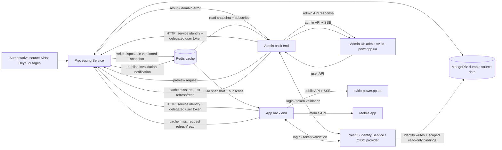

# ADR 0001: Service boundaries and dashboard data flow

- **Status:** Proposed
- **Date:** 2026-10-27

## Context

The current deployment has a main `back-end` that combines administrative APIs
with scheduled Deye polling, station synchronization, message delivery, data
cleanup, and dashboard logic. The `app-back-end` exposes the mobile API and
uses the same dashboard services to compute overlapping data. The front end
currently combines public pages and administrative screens. Redis is already
used for events, and SSE is handled by a separate `sse-back-end`.

These boundaries couple background work to web application lifecycles, duplicate
dashboard calculations, and make it difficult to expose public, administrative,
and mobile interfaces independently.

## Decision

### Services and responsibilities

Create a **Processing Service**, deployed as `svitlo-power-processor` and
implemented under `core/processing/`. It owns background and data-producing
work:

- Polling Deye and synchronizing station metadata and measurements.
- Computing canonical dashboard projections once for all consumers.
- Running data-retention cleanup.
- Running scheduled message generation and delivery (including Telegram).
- Publishing refreshed projections and change notifications to Redis.
- Owning all application-domain user records and bindings, including reporter
  profiles, site assignments, and domain permissions.

Keep the web applications responsible for client-facing protocols, identity,
authorization, request validation, and response shaping:

- **Admin front end** is served at `admin.svitlo-power.pp.ua`.
- **Admin back end** is the re-scoped existing `back-end`: administrative
  configuration and management APIs only. It must not poll Deye, compute
  dashboard projections, deliver scheduled messages, or perform scheduled
  cleanup.
- **Public front end** is served at `svitlo-power.pp.ua`.
- **App back end** remains the shared backend for public-page APIs and the
  mobile app. Keep its API contract stable for mobile clients.
- Move any currently public-facing API routes from the main back end to the
  app back end before restricting the main back end to the admin host.
- Both back ends subscribe to dashboard-change notifications, keep their own
  in-process copy of the latest authorized projection, and fan out SSE updates
  to their connected clients. The standalone `sse-back-end` is not part of the
  target topology; its SSE responsibilities move into these two API back ends.

The public and admin front ends may share UI components and source packages,
but are separate deployables with separate route sets. The public bundle must
not expose administrative screens or administrative API operations.

### Authentication and identity data

Implement a dedicated **Identity Service** in NestJS as an OIDC provider. It
owns credentials, authentication lifecycle, sessions/tokens, and identity
records. Use a standards-compliant OIDC implementation/library; do not
implement protocol cryptography or token validation from scratch.

The Identity Service uses the existing service MongoDB deployment because
identity records must link to existing application user bindings. Its database
access is restricted to identity-owned collections plus narrowly scoped
read-only access to the existing binding records needed to link accounts.
Processing remains the sole owner and writer of all application-domain user
records and bindings (including reporter profiles, site assignments, and
permissions); Identity links to those records using a stable OIDC subject
(`sub`) and does not become an alternative owner of domain data. Neither BFF
accesses MongoDB.

The admin and app BFFs integrate with OIDC and enforce access to their own
routes. BFF-to-Processing requests carry two distinct proofs: (1) service
identity, preferably mTLS/workload identity on the private network; and (2) a
short-lived, verifiable OIDC user access token or delegated actor token with
Processing as its audience. If token exchange is supported, use it to obtain a
least-privilege delegated token; otherwise pass the user's signed access token
for Processing to validate alongside the service identity. Do not forward
browser cookies or trust caller-supplied user IDs, roles, or headers.
Processing validates issuer, audience, expiry, and relevant claims, resolves
the OIDC subject to its domain user/bindings, and authorizes each domain
operation. Keep service-to-service authentication distinct from the acting
user's identity.

### Administrative operations and message preview

The processing service is the **only service allowed to access MongoDB for
application-domain data**. This includes reads as well as writes: neither the
admin back end nor the app back end connects directly to MongoDB. The Identity
Service is the only exception; its database credentials are limited to
identity-owned collections and read-only access to the minimum binding records
required for account linking. The processor remains the sole writer and owner of
application-domain data and exposes private, versioned JSON HTTP APIs for
domain commands and queries.

Administrative flows are synchronous request/response operations:

1. The admin UI calls the admin back end using its normal user session or
   access token.
2. The admin back end validates the user's session/token, checks route-level
   access, validates the UI-facing request, and calls the processor's private
   API using service identity plus the user's delegated identity token.
3. The processor validates both identities, resolves the OIDC subject to its
   domain user/bindings, authorizes the operation, applies the change to
   MongoDB, and returns a result or a domain error.
4. The admin back end maps the result to the admin API contract and responds
   to the UI.

All admin CRUD, including list and detail queries, follows this path. The admin
back end is a UI-facing API facade/BFF; it does not read or write MongoDB or
maintain a second copy of domain data. Processor endpoints are private to the
service network and protected by service credentials or workload identity.
Forward actor identity as a verifiable token or authenticated claim plus
explicit audit context; do not treat network location or caller-supplied user
IDs as authorization.

Message preview uses the same service boundary, for example
`POST /internal/v1/messages/preview`. The admin back end forwards the
authorized preview request to the processor. The processor loads the relevant
domain data and invokes the same message-generation logic used for delivery,
but in preview mode: it returns rendered content and metadata without sending,
queuing, or persisting a delivery. Sending remains a separate authorized
command. Preview input and output are versioned JSON contracts; the UI never
imports or runs the Python message generator itself.

### Synchronous APIs versus messaging

Use private HTTP APIs for CRUD, queries, and message preview because these
operations need an immediate result, validation errors, and a clear caller.
Do not implement request/reply over Redis Pub/Sub: it is ephemeral, has no
built-in correlation/recovery contract, and would make CRUD outcomes ambiguous.

Redis has two narrower roles:

- **Redis keys** hold derived, versioned dashboard projections and other
  explicitly cacheable data.
- **Redis Pub/Sub** carries best-effort projection invalidation notifications;
  it is not the source of truth and is not used for admin commands.

Do not add a general-purpose command bus for the initial CRUD and preview
flows. If later operations become long-running or must be accepted while a
consumer is unavailable, add asynchronous commands/events behind a
transport-neutral messaging interface. Specify the envelope, versioning,
correlation/idempotency keys, retry policy, and delivery guarantees separately
from the broker implementation. A durable broker or Redis Streams may then be
selected based on persistence, throughput, and operational requirements;
plain Redis Pub/Sub is not an adequate durable work queue.

This does not commit the service to Python or make a later NestJS migration
dependent on a broker choice. HTTP/OpenAPI and Redis JSON payloads are
language-neutral; either runtime can implement the same contracts. Keep
framework and client-library details behind service adapters, and select a
durable broker only when an actual asynchronous use case requires one.

### Projection and notification flow

MongoDB remains the durable store for application records. Dashboard and
outage-schedule snapshots are explicitly **disposable, rebuildable data**:
they can be lost and are refreshed from their authoritative source APIs. Redis
is a shared cache and notification transport for these snapshots, not their
durable source of truth. The processor owns producing and refreshing the
snapshots.

This applies to fetched dashboard and outage-schedule data, not to durable
application configuration that determines which sources or schedule settings
to use; such configuration remains owned by the processor's domain data.

The finite dashboard and outage-schedule fields used by both the public web
front end and mobile app are the same public dataset. Publish them together as
one versioned snapshot under one Redis key and use one notification channel.
Both BFFs consume this same contract; they do not compute separate variants.

For each snapshot refresh, the processor:

1. Fetches the latest required data from its authoritative API source(s) and
   builds a complete snapshot.
2. Writes/replaces the versioned snapshot in Redis.
3. Publishes a small notification containing the snapshot identifier and
   version only after the Redis write succeeds.

Redis Pub/Sub is an invalidation/refresh signal, not a durable event log and
not the snapshot itself. Each back end reads the current snapshot from Redis
on notification, updates its local cache only when the version is newer, and
emits the corresponding SSE update to its own connected clients. Notifications
may be missed; startup/reconnect reconciliation handles that.

If the Redis key is missing or expired, a back end requests a refresh/read from
the processor, which fetches the source data and repopulates the cache. A
back end must not become a second producer or write snapshots itself. If the
source API is unavailable, the snapshot may be unavailable or stale until it
can be fetched again; Redis recovery from a backup is not required.

The processor refreshes the snapshot at startup and whenever source data
changes. Where a source API has no push/change notification, detect changes
during the existing fetch/poll cycle and publish only when the snapshot changes.
Each back end subscribes before its initial snapshot read. It also reloads
snapshots after a Redis subscription reconnect and periodically reconciles
its local version with Redis, so a missed notification cannot leave a web
process stale indefinitely. SSE events carry the snapshot version as their
event identifier; clients fetch the normal API snapshot on initial connection
or SSE reconnect rather than relying on Pub/Sub replay.

### Host and API routing

The edge proxy routes each host to its matching static front end and API:

| Host | UI | API and SSE |
|---|---|---|
| `svitlo-power.pp.ua` | Public front end | App back end |
| `admin.svitlo-power.pp.ua` | Admin front end | Admin back end |
| Mobile clients | None | App back end's versioned public/mobile API |

Use host-aware routing rather than exposing both applications from one
single-page application. Keep the processing service, MongoDB, and Redis on the
private service network; only the edge proxy and intended API endpoints are
internet-facing. Configure explicit CORS origins and do not share broad
authentication cookies across the public and admin subdomains. Administrative
operations require admin authorization regardless of the hostname.

## Data ownership and contracts

- MongoDB is the durable source of truth for application records. Dashboard
  and outage-schedule snapshots are disposable derived data fetched again from
  their authoritative source APIs when absent; Redis is only their shared
  cache and notification transport.
- The public web front end and mobile app consume the same finite dashboard
  and outage-schedule dataset through one versioned snapshot contract, one
  Redis key, and one notification channel.
- The processor owns MongoDB access, domain persistence, computation, and
  projection schemas, as well as all application-domain user records and
  bindings.
- The NestJS OIDC Identity Service owns credentials, authentication lifecycle,
  and identity records in separately scoped MongoDB collections. It has only
  narrowly scoped read access to existing user-binding records for account
  linking; Processing remains their sole owner and writer. Neither BFF accesses
  MongoDB directly.
- Authenticate BFF-to-Processing requests with service identity (preferably
  mTLS/workload identity) and a separate, short-lived OIDC user/delegated token
  whose audience is Processing. Processing validates both, resolves the OIDC
  subject to its domain bindings, and makes authorization decisions.
- Internal processor APIs use language-neutral, versioned JSON contracts
  described with OpenAPI and JSON Schema. Do not make the API contract depend
  on Python packages, Python-specific serialization, MongoDB documents, or
  shared implementation models. The processor can therefore be replaced or
  migrated incrementally to NestJS without changing its callers.
- Internal API compatibility is explicit: additive optional fields are
  compatible; breaking request/response changes require a new version or a
  coordinated migration. Use stable domain identifiers and explicit error
  responses rather than leaking persistence-layer details.
- Each back end owns its public response and access-control policy. Never
  expose admin-only fields through the public/mobile projection.
- Administrative writes go through the processor's domain API and update
  durable source records. After a successful write, the processor refreshes
  affected snapshots and publishes a notification.
- Snapshot writes are atomic so readers cannot observe partial data. Include a
  monotonic version and generation timestamp. Refresh at processor startup and
  when source data changes; on a cache miss, a BFF requests Processing to
  recompute/refetch immediately. Coalesce concurrent refresh requests.
- Keep Redis access behind small cache and notification interfaces. Redis
  key/channel names and JSON payloads are documented, versioned contracts, not
  an application-wide assumption that every future service must use Redis.
- For any future durable asynchronous messaging, define a broker-independent
  interface and event envelope. A Python implementation and a NestJS
  implementation must be able to exchange the same versioned JSON messages;
  neither side should depend on Python classes or Redis client internals.
- Run one active scheduled processor initially. If processor replicas are
  introduced, require leader election or a renewable lease with fencing so
  multiple replicas cannot poll or send the same scheduled message concurrently.

## Consequences

### Benefits

- Deye integration, scheduled operations, cleanup, and message delivery no
  longer depend on web API process scaling or restarts.
- Dashboard computation has one owner and both web back ends consume the same
  result.
- Public, admin, and mobile interfaces can be deployed and secured separately.
- Each API back end can scale SSE connections independently while consuming
  the same projection updates.

### Costs and risks

- Redis, projection schemas, and event versions become explicit inter-service
  contracts that need compatibility and monitoring.
- Administrative API calls add an internal network hop and require the
  processor to be available for admin CRUD and previews. This is intentional:
  the admin back end must not bypass domain ownership by connecting to MongoDB.
- There are more independently deployed services and deployment dependencies.
- Pub/Sub is at-most-once; startup/reconnect reloads and reconciliation are
  required for correctness.
- Redis unavailability interrupts projection refresh and SSE updates. Back
  ends should retain their last-known in-process projection, mark it stale in
  health/metrics, and avoid silently presenting it as fresh.
- The public/admin UI split requires separating routes, build configuration,
  and authentication flows from the current combined front end.
- A single active processor is a scheduling bottleneck and needs monitoring;
  high availability later requires a safe lease/leader mechanism.

## Alternatives considered

1. **Keep background processing in the existing admin back end.** Rejected:
   web API scaling and lifecycle remain coupled to polling and scheduled work.
2. **Let both back ends compute dashboards independently.** Rejected: preserves
   duplicated logic and risks inconsistent calculations.
3. **Keep a single shared SSE gateway.** Rejected for the target design: each
   back end needs its own client authorization and SSE fan-out, and the gateway
   would remain an extra protocol hop. Redis notifications are shared; client
   connections are not.
4. **Use Redis Pub/Sub as the only data channel.** Rejected: notifications can
   be missed during disconnects and cannot provide a current snapshot to a new
   process or client.
5. **Use Redis Pub/Sub as a command bus for admin CRUD and previews.**
   Rejected: these are synchronous operations that need a durable outcome and
   immediate domain errors. Private HTTP APIs are simpler and do not couple
   the admin backend to Redis request/reply semantics.
6. **Let the admin back end access MongoDB directly.** Rejected: it splits
   domain ownership and persistence rules across services and makes the
   planned processor replacement harder.

## Migration plan

1. Define and version the dashboard projection schema and Redis key/channel
   conventions. Add contract tests for the processor and both consumers.
2. Define versioned OpenAPI contracts for processor-owned admin queries,
   mutations, and message preview. Add service authentication, authorization,
   actor/audit context, and contract tests before routing the UI through them.
3. Extract MongoDB domain access, polling, station synchronization, dashboard
   projection, cleanup, and scheduled message ownership into
   `core/processing/`. Ensure there is only one active scheduler.
4. Route all admin CRUD and preview requests through the admin back end to the
   processor. Remove the admin back end's MongoDB connection once every
   required read and write has a processor API.
5. Have the processor atomically publish complete Redis projections followed
   by versioned notifications. Update both back ends to subscribe,
   load/reconcile projections, serve their existing API response shapes, and
   fan out SSE. Remove duplicate dashboard calculations and retire
   `sse-back-end` after both consumers are verified.
6. Move public-facing routes from the main back end to the app back end, then
   split the front-end deployment into public and admin hosts, routing each
   host to its corresponding UI and API. Preserve the mobile API contract.
7. Roll out incrementally with comparison metrics for old versus new dashboard
   responses, then remove the old computation and background jobs.

## Open questions before implementation

- Which processor operations, if any, are sufficiently long-running to need a
  durable asynchronous command flow rather than synchronous HTTP?
- What exact source-change signals or polling intervals are available from the
  upstream APIs, and what operational stale-data alert threshold follows from
  their expected update cadence?
- Which standards-compliant NestJS OIDC provider implementation will be used,
  and does it support token exchange for delegated BFF-to-Processing calls?
